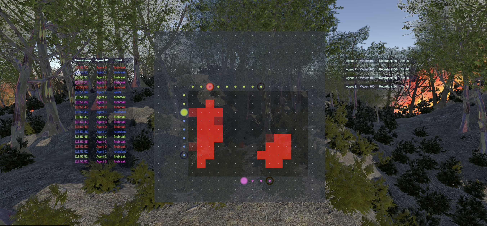
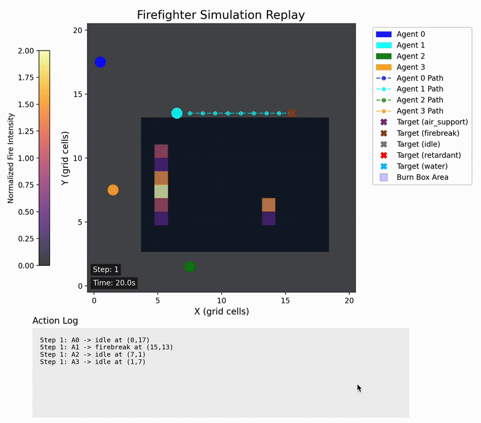
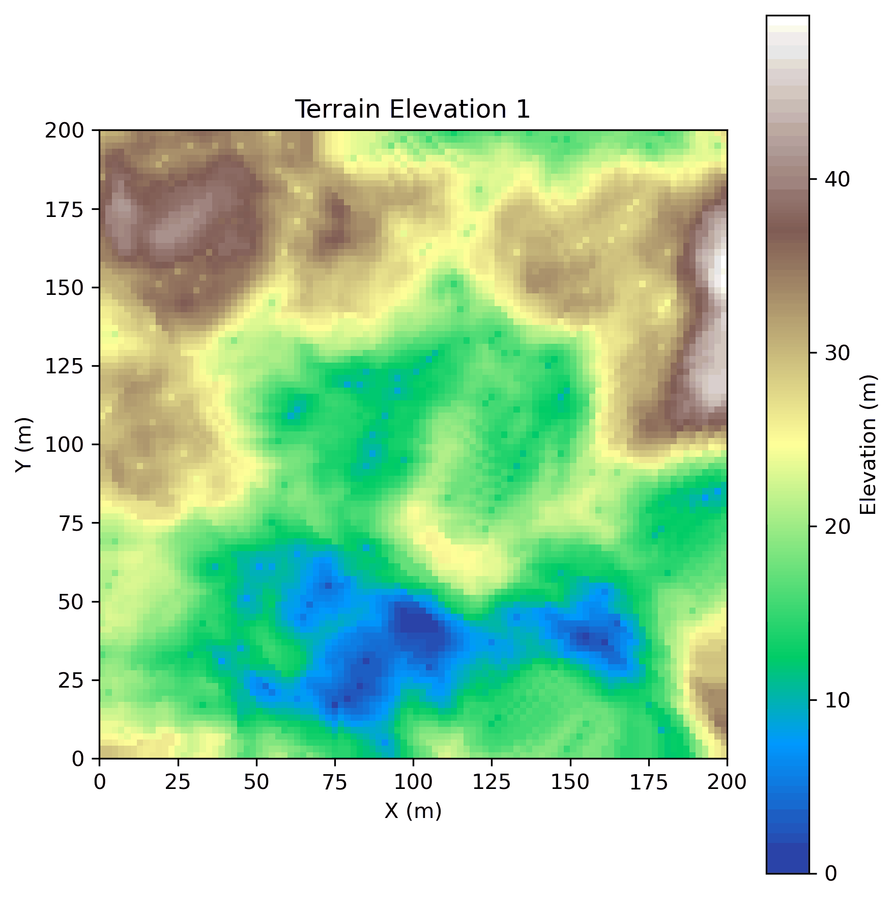
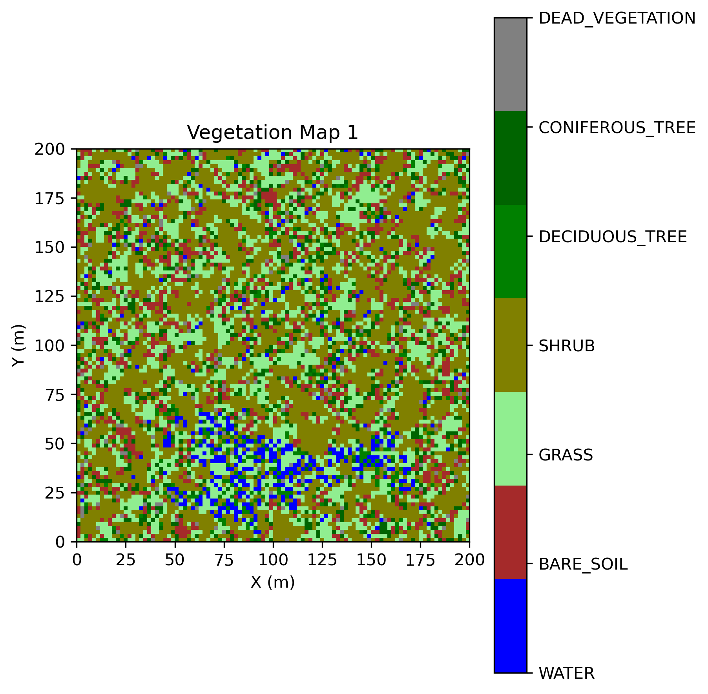

# Ember

Ember is an AI-powered wildfire training platform that combines large-scale fire behavior simulation, procedural environments, reinforcement learning agents, and XR visualization for realistic firefighter decision-making practice.

It was built by hand in five weeks in August 2025: a Python fire-spread model, an option-critic firefighter with D\* Lite pathing and an Elo curriculum, ONNX export, and a Meta Quest 3 front end.

<p align="center">
  
</p>

<p align="center">
  <strong>Procedural wildfire scenarios. Multi-agent AI firefighters. Immersive XR training on Meta Quest 3.</strong>
</p>

<p align="center">
  <a href="#architecture">Architecture</a> |
  <a href="#system-visuals">System Visuals</a> |
  <a href="#how-to-run">How to Run</a> |
  <a href="#headset-front-end">Headset</a>
</p>

## Architecture

Training happens on the desktop. The headset loads a finished policy and steps the same simulation.

```
procedural terrain, vegetation, fuel, and moisture
        |
        v
QuicFireEngine          energy-packet spread, wind, plumes
        |
        v
FirefighterEnvironment  observations, suppression actions, rewards, D* Lite
        |
        v
OptionCriticAgent       desktop training (TrainFirefighterOptionCritic.py)
        |
        v
ONNX policy             PolicyExporter.export_to_onnx
        |
        v
InferFirefighterOptionCritic.py
                        ONNX Runtime on CPU, one sim step per call, JSON for the renderer
        |
        v
unity/                  Quest 3 front end
                        GPU burn map, 2.5D fluid smoke, plume particles
                        PythonInferenceBridge.cs calls the packaged Python
```

`InferFirefighterOptionCritic.py` is the Python side of the headset. `setup_environment`, `setup_agent`, `setup_episode`, and `step_episode` load the ONNX policy, advance the fire, and write JSON. `PythonInferenceBridge.cs` in `unity/Assets/` is the C# bridge that calls those hooks. `is_training=False` on that path, and the device is pinned to CPU. Weight updates live in `TrainFirefighterOptionCritic.py`.

## Project Purpose

Ember is a trainer for practicing wildfire decisions against a physics-style fire, with the visualization aimed at a standalone Meta Quest 3.

### Key Components

**Fire-spread engine.** Influenced by QUIC-Fire from Los Alamos National Laboratory (Linn et al., 2020). This tree is an original Python model: energy packets move on a 3D grid, fuel and moisture sit on that grid, and a wind field and a Briggs/McCaffrey plume model feed the spread. The LANL Fortran solver and the `quicfire-tools` input decks are separate projects.

**Option-critic firefighter.** One network controls every agent. Each agent holds an option (a suppression type and a target cell) until the termination head ends it. D\* Lite plans movement around heat. An Elo curriculum manager rates environments against the agent.

**Procedural ground.** Terrain, rivers, biomes, and fuel maps are generated from a master seed (`QuicFireEnvGenerator.py`), so a scenario can be rebuilt exactly.

**ONNX deployment.** Training writes the policy with `PolicyExporter`. The inference module runs that file through ONNX Runtime.

## System Visuals

The figures below were made for this project: a headset HUD screenshot, a top-down training replay, and the procedural map animations produced by `QuicFireEnvGenerator.py`.

### AI Firefighter Training

<p align="center">
  
</p>

The replay is a top-down view of the training environment. Several agents pick suppression actions, walk the grid, and work a simulated fire.

### Procedural Environment Generation

| Terrain Elevation | Vegetation and Fuel Types |
| --- | --- |
|  |  |

Terrain and vegetation maps are generated procedurally across fuel types and elevation.

### Figures included with this snapshot

| File | What it is |
| --- | --- |
| `assets/readme/Ember_HUD.png` | Headset HUD screenshot, 2706×1256 |
| `assets/readme/AI_Training_60.gif` | Training replay, 800×703, 300 frames |
| `assets/readme/terrain_animation.gif` | Procedural elevation series, 15 frames |
| `assets/readme/vegetation_animation.gif` | Procedural vegetation series, 15 frames |

## Repository Map

```
.
├── QuicFire/                          # Fire-spread model and scenario generator
│   ├── QuicFireEngine.py              # Grid state, energy packets, combustion, plumes
│   ├── QuicFireSimulation.py          # Run, calibrate, and stress-test a scenario
│   ├── QuicFireBurnBox.py             # Prescribed-burn target rectangle
│   ├── QuicFireConstants.py           # Physical parameters, rewards, BASE_CONFIG
│   ├── QuicFireWindFieldManager.py    # Terrain-aware wind and updraft
│   ├── QuicFireIgnitionManager.py     # Ignition lines
│   ├── QuicFireEnvGenerator.py        # Terrain, biomes, vegetation, fuel moisture
│   ├── QuicFireVisualizer.py          # Fire-spread plots
│   ├── QuicFireTuning.py              # Allowlisted overrides (time step, rewards, Briggs/McCaffrey)
│   └── RNGCollection.py               # Per-module seeds from one master seed
│
├── AI/                                # Firefighter policy
│   ├── FirefighterEnvironment.py      # Gymnasium environment around the engine
│   ├── OptionCriticAgent.py           # Option-critic loop
│   ├── OptionCriticNetwork.py         # Depthwise conv net, four heads
│   ├── OptionReplayBuffer.py          # Completed-option trajectories
│   ├── EloCurriculumManager.py        # Elo pool, burn-in, regeneration
│   ├── PolicyExporter.py              # ONNX export
│   ├── DStarLite.py                   # Incremental pathing
│   └── Debugging/                     # Replay and reward plots
│
├── unity/                             # Quest 3 front end (scripts)
│   ├── README.md
│   ├── .gitignore
│   ├── Assets/                        # C#, shaders, PythonInferenceBridge.cs
│   │   └── Python4Unity_Sample/Python # Python that Chaquopy packages onto the headset
│   ├── Packages/manifest.json
│   └── tests/
│
├── TrainFirefighterOptionCritic.py    # Desktop training entry point
├── InferFirefighterOptionCritic.py    # ONNX inference entry point (headset hooks)
├── QuicFireMain.py                    # Standalone simulation
├── requirements.txt
└── assets/readme/                     # Figures above
```

The headset scripts are under [`unity/`](unity/). See [Headset front end](#headset-front-end).

## Features

### Fire simulation

- Energy packets emitted from burning cells and moved with a wind-biased kernel
- 3D fuel density and moisture built from the vegetation map and the terrain height
- Burnout time, heat release, and an oxygen factor that falls off with height
- Surface, midstory, and canopy consumption accumulated by height band
- A log-profile wind field, terrain slope, and Briggs/McCaffrey plume rise
- Climate inputs (temperature, humidity, precipitation) that shape moisture in the generator
- Ignition lines and a burn box the agents are scored against

### AI agents

- Option-critic policy: action-type head, joint target-cell head, termination head, value head
- Action types: `water` (0), `firebreak` (1), `retardant` (2), `air_support` (3), `idle` (4)
- Water, firebreak, and retardant are local. Air support and idle are global and can be delayed a few steps
- Default crew size is 4 agents sharing one network (`DEFAULT_NUM_AGENTS`)
- D\* Lite navigation with heat and burn-box costs
- Elo curriculum: environment pool, burn-in, and rating updates in `AI/EloCurriculumManager.py`
- ONNX export of the four network heads

The trainer that matches the current network is `TrainFirefighterOptionCritic.py`. The Elo manager is a separate module with its own `__main__`. That block is behind the agent it was written against: it imports `save_config_to_file` and `save_checkpoint` from `OptionCriticAgent` (those functions are defined in `TrainFirefighterOptionCritic.py`), it constructs `OptionCriticAgent` with an `env_template` argument the current constructor has no parameter for, and its episode loop unpacks an older network and `step` signature. Treat that file as the curriculum design. Run training through `TrainFirefighterOptionCritic.py`.

`PolicyExporter.export_to_onnx` is the path the trainer uses. `PolicyExporter.extract_policy_inference_model` still looks for separate `target_x_head` and `target_y_head` attributes. The network exposes `target_xy_head` instead.

## Installation

Python 3.8+ . Training uses CUDA when `torch.cuda.is_available()` is true, and otherwise stays on CPU.

```bash
git clone https://github.com/theorem-stack/Ember-community.git
cd Ember-community
pip install -r requirements.txt
```

Pinned in `requirements.txt`:

```
gymnasium==1.2.0
matplotlib==3.10.3
scikit-image==0.25.2
numpy==1.26.4
scipy==1.16.0
torch==2.6.0
onnx==1.18.0
onnxruntime==1.22.1
```

Regenerating the terrain and vegetation GIFs (`create_gifs_from_images` in `QuicFireEnvGenerator.py`) imports Pillow, which is outside `requirements.txt`. The simulation, trainer, and inference script import the packages listed above.

## How to Run

### Fire simulation

```bash
python QuicFireMain.py
```

This builds one generated scenario from `QuicFireConstants.DEFAULT_RANDOM_SEED` and runs it. `run_fire_simulation` visualizes by default, so Matplotlib needs a display or a non-interactive backend.

Stress testing and calibration are implemented as `stress_test_simulations` and `calibrate_simulation_params` in `QuicFire/QuicFireSimulation.py`. The calls in `QuicFireMain.py` are commented out. `run_failed_simulation` in that module still invokes `run_fire_simulation` with a `module_rngs` keyword and no climate argument. The live signature is `run_fire_simulation(base_config, module_seeds, climate, verbose=True, visualize=True)`.

### Train

```bash
python TrainFirefighterOptionCritic.py
```

The script reads `QuicFireConstants.BASE_CONFIG`, trains, and writes under `Training/` (created next to the script):

- `firefighter_policy_config_<timestamp>.json`
- `firefighter_policy_batch_<episode>_<timestamp>.onnx`
- `firefighter_log.txt` (episode, reward)
- `reward_plots/` when reward logging is on

`DEFAULT_NUM_EPISODES` is `1`. A checkout run is a single episode plus an ONNX checkpoint. Raise `num_episodes` in `BASE_CONFIG` for a longer run. Checkpoints are written when the episode reward improves, every 10 episodes, and on the final episode.

The agent hyperparameters used by `initialize_agent` are the `BASE_CONFIG` values: learning rate `3e-4`, gamma `0.99`, entropy beta `0.01`, termination beta `0.01`, buffer `10000`, batch `64`, reward alpha `0.8`.

`main_training` takes an optional `tuning` dict and applies it before `total_time / DT`, so the episode length follows the new time step. Leave it out and every allowlisted constant stays at its default.

```python
from TrainFirefighterOptionCritic import main_training

main_training(tuning={
    "DT": 10.0,
    "WIN_PERCENT_FUEL_BURNED_OUTSIDE_BB_THRESHOLD": 0.1,
    "BRIGGS_RISE_COEFF": 1.8,
})
```

`QuicFire.QuicFireTuning.apply_tuning` sets `DT`, `H_SF` (surface-fuel height, default 5.0 m), reward scales, the win threshold, and the Briggs/McCaffrey coefficients (`BRIGGS_RISE_COEFF`, `MORTON_RISE_COEFF`, `MCCAFFREY_VELOCITY_COEFF`, and the plume caps). Leaving a coefficient out keeps the desktop literal (`BRIGGS_RISE_COEFF` 1.6, `MCCAFFREY_VELOCITY_COEFF` 1.9). Packet-only names such as `PLUME_HEIGHT_FACTOR` and `PLUME_K` are ignored. `apply_document` reads a training JSON file: allowlisted `quicfire_constants`, then an optional top-level `tuning` object. `InferFirefighterOptionCritic.setup_environment` does that before it divides by `DT`.

Trained weights are not part of this snapshot. `Training/`, `*.onnx`, and `*.npy` are gitignored.

### Inference

`InferFirefighterOptionCritic.py` expects a policy and a config the trainer already wrote. The `__main__` block points at:

- `TrainedModels/firefighter_policy_batch_0_20250804_143554.onnx`
- `TrainedModels/firefighter_policy_config_20250804_143517.json`

This branch ships source, so point `setup_agent` and `setup_environment` at a checkpoint you trained, then call `setup_episode` and `step_episode`. Each step appends nothing: it overwrites the episode JSON with the latest `viz_data` payload (fires, embers, plumes, agents, heat flux).

```python
from QuicFire.QuicFireEnvGenerator import ClimateConditions
from QuicFire.QuicFireSimulation import run_fire_simulation
from QuicFire.RNGCollection import RNGCollection

base_config = {
    'nx': 100, 'ny': 100, 'nz': 50,
    'dx': 2, 'dy': 2,
    'total_time': 10000,
    'random_seed': 12243261,
}

climate = ClimateConditions(
    temperature=260,      # Kelvin
    humidity=0.6,
    precipitation=600.0   # mm/year
)

module_seeds = RNGCollection(base_config['random_seed'])
results = run_fire_simulation(base_config, module_seeds, climate, visualize=True)
```

```python
from AI.FirefighterEnvironment import FirefighterEnvironment

env = FirefighterEnvironment(
    grid_size=(20, 20),
    max_steps=1000,
    num_agents=4,
    sim_base_config=base_config,
    module_seeds=module_seeds,
    climate=climate,
)
```

`FirefighterEnvironment` subclasses `gymnasium.Env`. `step` returns `(observation, per_agent_rewards, done, info)`.

## Configuration

`QuicFireConstants.BASE_CONFIG` is the dictionary the trainer uses:

| Key | Default | Role |
| --- | --- | --- |
| `nx`, `ny`, `nz` | 100, 100, 50 | Simulation grid |
| `dx`, `dy` | 2 m | Horizontal cell size |
| `max_grid_height` | 300 m | Top of the vertical grid |
| `max_elevation` | 50 m | Terrain generator cap |
| `total_time` | 10000 s | Episode horizon |
| `num_episodes` | 1 | Trainer episodes |
| `obs_grid_x`, `obs_grid_y` | 20, 20 | Agent observation grid |
| `num_agents` | 4 | Firefighters on the shared policy |
| `random_seed` | 12243261 | Master seed |

## Observation Space

The observation is a float32 box of shape `(obs_grid_x, obs_grid_y, 9)`, default `(20, 20, 9)`. The network permutes that to channels-first before the convolutions.

| Channel | Name |
| --- | --- |
| 0 | `heat_flux` |
| 1 | `energy_packets` |
| 2 | `temperature` |
| 3 | `fuel_density` |
| 4 | `moisture_fraction` |
| 5 | `wind_magnitude` |
| 6 | `agent_positions` |
| 7 | `burn_box` |
| 8 | `placeholder` |

## Action Space

`select_and_execute_options` returns one row per agent: `[agent_idx, action_type, x, y]`, with `x` and `y` on the observation grid. The environment consumes that array in `step`.

Agents spend finite water, retardant, and air-support charges. A firebreak has no resource cost. Ranges and capacities are the `WATER_*`, `RETARDANT_*`, `AIR_SUPPORT_*`, and `FIREBREAK_*` constants in `QuicFireConstants.py`.

## Reward

The score is a prescribed-burn containment objective. Fuel burned inside the burn box is rewarded. Active fire and fuel loss outside the box are penalized, along with water, retardant, air support, time, invalid actions, and movement. A contained mission and a fire that escapes or times out use the mission constants in `QuicFireConstants`. Per-agent reward is blended with the global reward by `reward_alpha` (default 0.8).

## Headset front end

The Quest 3 front end lives in [`unity/`](unity/) (notes in [`unity/README.md`](unity/README.md)).

- **GPU burn map** (`BurnMap.compute`): splats fire state from the simulation into a burn texture that drives vegetation and heat.
- **GPU fluid smoke** (`HeadsetFluid.compute`): a 2.5D layered grid (default 64×64×4) with semi-Lagrangian advection, viscosity, heat-driven buoyancy, ambient wind forcing, dissipation, and a Jacobi pressure projection. Plume particles (`PlumeFluidParticles.shader`) are advected by this velocity field. All parameters are exposed in the Unity Inspector, sized for the Quest 3's mobile GPU.
- **On-device inference**: `PythonInferenceBridge.cs` calls `InferFirefighterOptionCritic.py` through embedded CPython (Chaquopy). The headset loads an ONNX policy and steps the simulation offline; training stays on the desktop in `TrainFirefighterOptionCritic.py`.
- **Packaged Python**: `unity/Assets/Python4Unity_Sample/Python` is the copy Chaquopy packages onto the headset. The repository root is the canonical source, and the two copies are kept in sync. `QuicFireEngine.py`, `QuicFireConstants.py`, and `QuicFireTuning.py` are the same file in both places: `H_SF` is 5.0 m, and plume height, tilt, vertical velocity, and turbulence come from the Briggs/McCaffrey model. The headset still reads the same JSON fields (`origin_position`, `plume_u`, `plume_v`, `plume_w`, `total_heat`, `h_sub`, `ell`, `k`). `QuicFireTuning.py` overrides the time step, `H_SF`, reward weights, the win threshold, and those Briggs/McCaffrey coefficients from code or JSON.

These headset-only differences remain:

- Matplotlib stays off the Quest import and step path. Training replay, reward charts, `run_fire_simulation` visualization, and the wind-field plot are commented out in the headset copy. The root still runs them. `QuicFireVisualizer.py` imports matplotlib, and the headset environment only imports the debugging plotters when `enable_viz_recorder` is true. Inference sets that flag to false.
- The headset inference `__main__` walks the episode. The root script takes one step.
- The root `QuicFireIgnitionManager.py` keeps a commented-out ignition plot the headset copy does not.
- The root environment generator can write the terrain and vegetation GIF series. The headset copy's `__main__` builds one map.

The Unity scene, art, and third-party packages (Chaquopy4Unity, Meta XR/OpenXR, Asset Store packs) are not included.

## Provenance

The Python in this branch was written for Ember.

- Searches for project-specific names (`QuicFireEngine`, `DEFUALT_SIMULATION_TIME`, `PENALTY_ACTIVE_FIRE_OUTSIDE_BB`, `EloCurriculumManager`) do not turn up a public copy of these files.
- LANL QUIC-Fire is a Fortran wind and cellular-automata model with its own input-deck tools. None of that source is in this tree. The engine follows the published energy-packet idea and uses its own grid, agent, and burn-box code.
- `AI/DStarLite.py` is a project implementation of D\* Lite (Koenig and Likhachev, 2002), with cost and neighbor functions injected by the environment. Public ports such as PythonRobotics and `mdeyo/d-star-lite` use different node types and queues. Any D\* Lite implementation shares structure with the paper's pseudocode.
- The option-critic losses follow Bacon, Harb, and Precup (2017) and are written against this network and this replay buffer.

## Scientific background

**Linn, R. R., Goodrick, S., Brambilla, S., Brown, M. J., Middleton, R. S., O'Brien, J. J., and Hiers, J. K. (2020).** "QUIC-fire: A fast-running simulation tool for prescribed fire planning." *Environmental Modelling & Software*, 125, 104616.

**Bacon, P.-L., Harb, J., and Precup, D. (2017).** "The Option-Critic Architecture." AAAI.

**Koenig, S., and Likhachev, M. (2002).** "D\* Lite." AAAI.

## Output files

A training run and a simulation can write:

- `*.onnx` policy checkpoints
- `firefighter_policy_config_*.json` run configuration, including a dump of `QuicFireConstants`
- `firefighter_log.txt` episode rewards
- `calibration_results.json` from `calibrate_simulation_params`
- `failed_simulations.json` from `stress_test_simulations`
- `reward_plots/*.png` from `AI/Debugging/RewardVisualizer.py`
- `UnityVisuals/environment_data.json` and `episode_data.json` when the inference `__main__` path is used

Those outputs are generated artifacts. This snapshot keeps the Python source and the four figures in `assets/readme/`.

## History

The original simulation, RL agent, and Quest 3 app were built by hand in five weeks in August 2025.
In October 2026 the code was cleaned up for public release and the documentation was rewritten.

## License

MIT. Copyright (c) 2025-2026 Cameron Gifford. See [LICENSE](LICENSE).

## Citation

```bibtex
@software{ember2026,
  title={Ember: Wildfire Simulation and AI Firefighter Training},
  author={Gifford, Cameron},
  year={2026},
  url={https://github.com/theorem-stack/Ember-community}
}
```

## Acknowledgments

- QUIC-Fire model by Los Alamos National Laboratory (Linn et al., 2020)
- Option-critic architecture by Bacon, Harb, and Precup (2017)
- D\* Lite by Koenig and Likhachev (2002)
- Gymnasium, PyTorch, and ONNX Runtime
